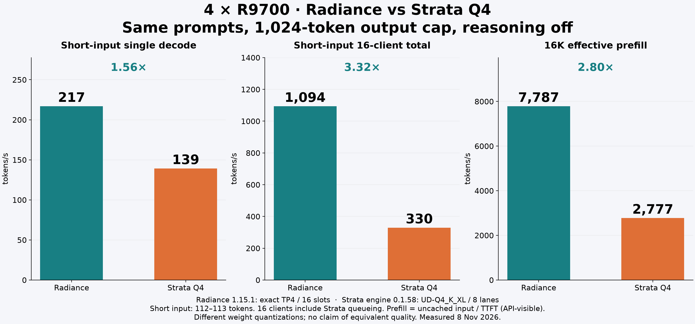
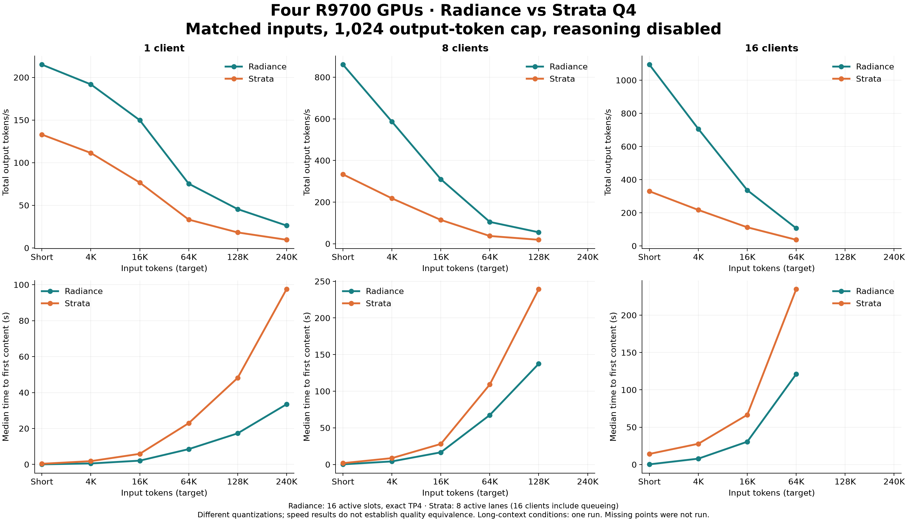
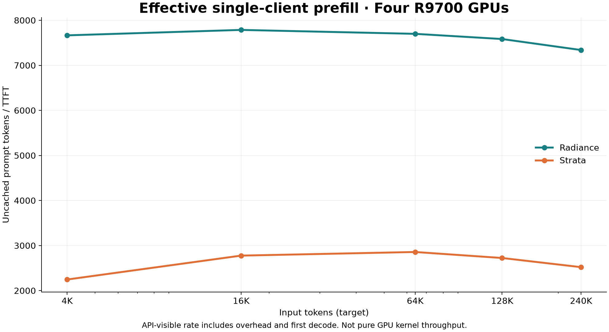

# 四张 R9700：Radiance 与 Strata Q4 的不同输入长度对照

[English](README.md) · [配置](configuration.json) · [汇总数据](results.csv) · [逐批数据](bursts.csv) · [逐请求数据](requests.csv)

测试日期：2026-11-08。共 48 批、370 条请求，**370/370 成功**。相同提示词、相同 1024 token 输出上限、关闭思考、零前缀缓存命中；每套引擎处理 4,095,207 输入 token、输出 189,440 token。

- 短输入单路生成：**217.0 vs 139.3 token/s，1.56×**。
- 短输入 16 客户端总吞吐：**1094.1 vs 329.7 token/s，3.32×**。
- 16K 冷输入有效 prefill：**7786.6 vs 2776.7 token/s，2.80×**。

硬件为四张 32 GB R9700、EPYC 7452、约 252 GiB 主机内存；每卡功率上限设定 250W。Radiance 1.15.1 使用 exact TP4、16 槽、FP8 KV 和 `flash.rad`；Strata 官方引擎 0.1.58 使用 UD-Q4_K_XL、8 槽、int8 KV、MTP=6。完整技术参数见公开配置文件。

**这是两种服务配置的速度比较，两套权重量化不同，不代表质量相同。Strata 的 16 客户端包含 8 个活动槽之外的排队。** 两边配置上限均为 262144；本报告改变实际输入长度，而不是逐档改变配置上限。本分支仅用于发布报告，仓库代码不是本次测试二进制的构建版本。

## 完整条件对照

“总吞吐”包含 prefill、排队和生成；“首字”是第一段正文到达时间。完整单条首字后输出速度、实际输入 token、最大首字时间和每条回执见[英文报告](README.md)和公开 CSV。并发下首字后速度也包含被其他请求 prefill 或调度打断的时间，不是纯解码内核速度。短/4K/16K 各条件两轮，长输入各一轮；长输入结果不代表稳定的 p95 保证。

| 输入目标 | 客户端 | Radiance 首字 p50 秒 | Strata 首字 p50 秒 | Radiance 总 token/s | Strata 总 token/s | Radiance 成功 | Strata 成功 |
|---|---:|---:|---:|---:|---:|---:|---:|
| 短输入 | 1 | 0.046 | 0.355 | 215.0 | 133.0 | 2/2 | 2/2 |
| 短输入 | 8 | 0.159 | 1.790 | 860.4 | 333.2 | 16/16 | 16/16 |
| 短输入 | 16 | 0.264 | 14.205 | 1,094.1 | 329.7 | 32/32 | 32/32 |
| 4096 | 1 | 0.536 | 1.830 | 191.8 | 111.4 | 2/2 | 2/2 |
| 4096 | 8 | 4.167 | 8.640 | 586.6 | 217.9 | 16/16 | 16/16 |
| 4096 | 16 | 7.879 | 27.814 | 706.1 | 217.0 | 32/32 | 32/32 |
| 16384 | 1 | 2.106 | 5.905 | 149.8 | 76.6 | 2/2 | 2/2 |
| 16384 | 8 | 16.578 | 28.008 | 309.8 | 114.3 | 16/16 | 16/16 |
| 16384 | 16 | 30.579 | 66.608 | 336.5 | 112.4 | 32/32 | 32/32 |
| 65536 | 1 | 8.514 | 22.944 | 75.4 | 33.2 | 1/1 | 1/1 |
| 65536 | 8 | 67.471 | 109.184 | 104.8 | 37.2 | 8/8 | 8/8 |
| 65536 | 16 | 121.164 | 234.810 | 106.6 | 37.0 | 16/16 | 16/16 |
| 131072 | 1 | 17.284 | 48.126 | 45.6 | 18.2 | 1/1 | 1/1 |
| 131072 | 8 | 137.471 | 239.263 | 55.0 | 18.9 | 8/8 | 8/8 |
| 245760 | 1 | 33.483 | 97.505 | 26.3 | 9.6 | 1/1 | 1/1 |

## Prefill、容量和 agent 使用含义

有效 prefill = 未缓存的输入 token / 首字时间，包含 API 开销及第一步解码，不能和纯 GPU kernel prefill 数值直接混比。所有正式测速缓存命中已逐条核对；本轮 Radiance 为零缓存命中、零运行中抢占。

Radiance 是 16 个活动槽，Strata 官方 split 引擎本次只能同时处理 8 个槽。Strata 的“16 路”指 16 个客户端，其中包含排队。两个服务都声明每请求 262144 上限，但共享 KV 容量不同：Radiance 1,687,360 token，Strata 启动时可用 416,256 token。不能把上限乘以并发数当作可同时保留的缓存。

128K×16、240K×8/16 未测试：它们超过 Radiance 当前共享 KV 池可同时保留的提示词总量，属于另一个超额分配/抢占压力测试范围，本报告不将其标为通过。64K×16 和 128K×8 已实际发出整批请求；Strata 容量不足时的内部等候包含在结果中。启动与准入日志实见 64K 条件最多 6 个槽解码、128K 条件最多 3 个槽解码。这是本次固定配方的结果，未穷尽所有 KV/专家缓存调参方案。

短提示词/缓存命中时，Radiance 的 16 槽能明显提高吞吐；大量新增长历史同时进入时，主要成本变为 prefill。Radiance 64K 冷输入从 8 客户端增加到 16 客户端，总吞吐约 105→107 token/s，首字中位数却从约 67→121 秒。因此 agent 应尽量复用同一会话的前缀，减少不必要的历史重写和同时提交长冷上下文；

## 缓存、图片和工具调用

单独用 128 token 输出上限检查缓存：Radiance 16K 首字从 2.106 秒降到 0.032 秒，追加一轮为 0.063 秒；Strata 从 6.272 秒降到 0.145 秒，追加一轮为 0.299 秒。两边都正确识别了合成图片里的文字、柱状图最大值、颜色及总和，简单工具选择和城市参数各通过 3/3。样本很小，不是完整 agent 或视觉质量评测。

测速使用合成工程词汇输入，不评测长上下文检索能力。`finish_reason=length` 是达到设定输出上限，不等于开放式任务语义完整。数据文件只包含性能、用量和完成状态；不包含服务部署信息、维护记录或完整生成正文。
