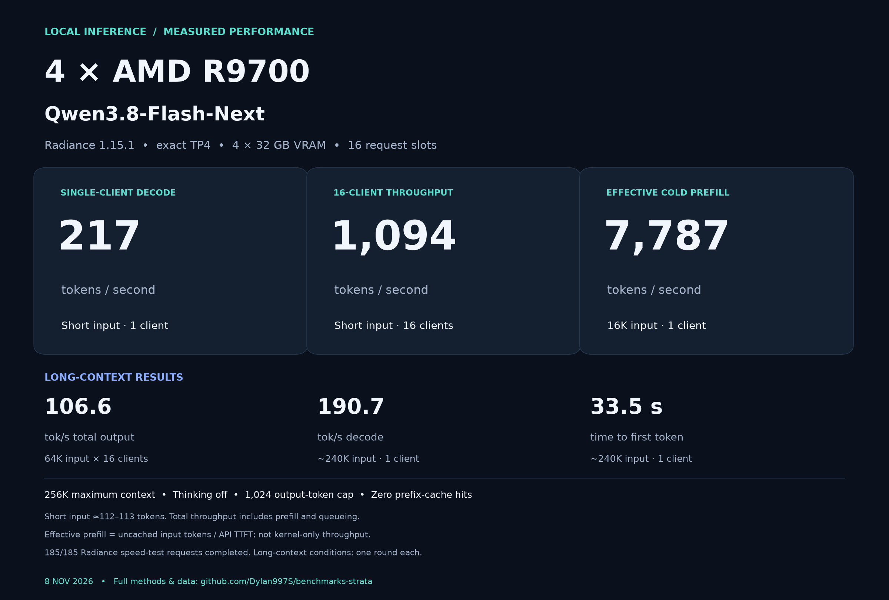
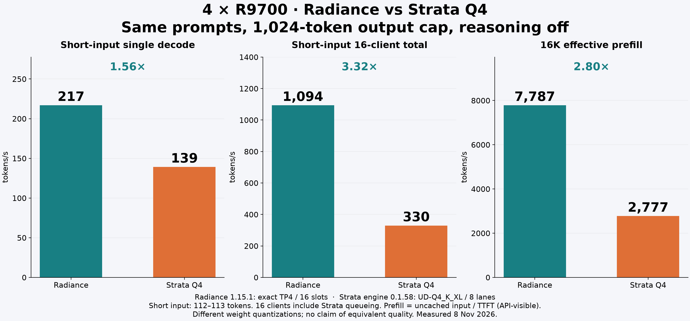
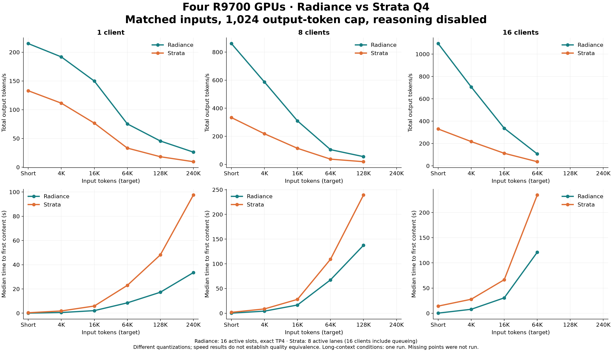
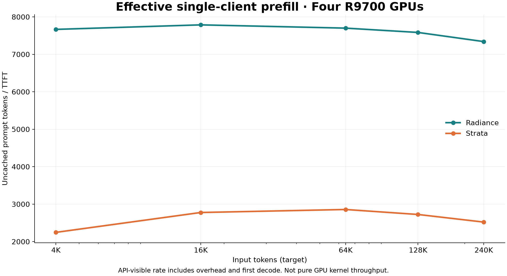

# Four R9700 GPUs: Radiance vs Strata Q4

[简体中文](README.zh-CN.md) · [Configuration](configuration.json) · [Summary data](data/results.csv) · [48 bursts](data/bursts.csv) · [370 requests](data/requests.csv)

Measured on **8 November 2026**. Same host, same saved prompts, 1,024 output tokens per request, thinking disabled, zero prefix-cache hits. All **370/370** formal requests completed successfully. Each engine processed **4,095,207 input tokens** and generated **189,440 output tokens**; all 185 paired prompt hashes and API input-token counts matched.

| Headline metric | Radiance 1.15.1 | Strata engine 0.1.58 / UD-Q4_K_XL | Ratio |
|---|---:|---:|---:|
| Short-input single-client decode | 217.0 tok/s | 139.3 tok/s | 1.56× |
| Short-input 16-client total output | 1,094.1 tok/s | 329.7 tok/s | 3.32× |
| Effective cold 16K prefill | 7,786.6 tok/s | 2,776.7 tok/s | 2.80× |

**Scope:** this compares two serving configurations and different weight quantizations of Qwen3.8-Flash-Next. It is not a quality-equivalence claim, an upstream-certified benchmark, or an exhaustive tuning search. Strata has **eight active lanes** here; its sixteen-client result includes queueing. Short input is approximately 112–113 tokens. Effective prefill means uncached prompt tokens divided by API time to first content, not a kernel-only metric.

## Radiance four-GPU performance snapshot

[Download the full-resolution numbers graphic](assets/r9700-qwen38-radiance-numbers.png). This graphic summarizes Radiance's 185 formal requests; the full comparison below covers 370 requests across both engines.

## Hardware and weights

- Four R9700 GPUs, nominally 32 GB each; configured power caps of 250 W/card.
- AMD EPYC 7452, 32 cores / 64 threads, four NUMA domains, approximately 252 GiB host RAM.
- Radiance 1.15.1, revision `203064b4877f`, `flash.rad` container (121,969,901,568 bytes). This report does not assign the container the GGUF label UD-Q4_K_XL.
- Strata official engine 0.1.58 HIP RX9070 build, source label `f-amd-vision 7be42963e6be`, `Qwen3.8-Flash-Next-UD-Q4_K_XL-00001-of-00004.gguf` and three companion shards. No custom Q5/v31 engine patch was used.
- Both were configured for a **262,144-token maximum context**. The input length changes across tests; the configured maximum stays fixed. Embedding/n-gram tables remain in host RAM as specified in [configuration.json](configuration.json).

This repository publishes benchmark reports. The archived source checkout is not the source revision of the tested runtime binaries.

## Configuration and method

- Same host and four GPUs, 250 W configured cap per GPU. Engine versions and per-engine configuration retained.
- Radiance: tested build 1.15.1, four-way tensor parallel, exact wire, P2P, all_vram placement with n-gram tables explicitly in host RAM, FP8 KV, 262144 per-request maximum, sixteen sequence slots, speculative tokens 3.
- Strata: installed official 0.1.58 HIP RX9070 engine, UD-Q4_K_XL GGUF, four-card split, host exchange, int8 KV, MTP 6, lookup 15, eight engine lanes. Sixteen HTTP clients include queueing. Loaded and verified a 262144 limit; full-VRAM experts (FNX_ARENA=0, FNX_EXPERT_RAM_GIB=off), FNX_PEER=0, token/per-layer embedding tables in host RAM.
- These are different quantizations of the same model family, not byte-identical weights. Speed comparison does not establish quality equivalence.
- Same saved prompt files across engines; deterministic independent random engineering-note filler to prevent cross-request prefix reuse. Requested user-content lengths: short,4096,16384,65536,131072,245760. Actual API prompt usage includes chat template.
- Simultaneous barrier release for 1,8,16 HTTP clients; 1024 maximum output tokens, temperature 0, reasoning_effort none. Requests deliberately ask for more prose than the cap, so finish_reason=length is expected, not a failed answer.
- Two rounds per short/4K/16K condition, one per long condition. Long tests are capacity observations, not a statistical confidence interval.
- 1/8/16 clients through 64K; 1/8 at128K; 1 at240K. Omitted combinations exceed the Radiance pool at aggregate full-resident prompt length and are outside the non-oversubscribed matrix. No claim of supporting sixteen simultaneous full-256K requests.
- TTFT: barrier release to first nonempty content delta, includes HTTP, queue, prefill and first decode.
- Decode tok/s: (API completion_tokens-1)/(last content time-first content time). Approximate because SSE chunks may contain multiple tokens. Engine-independent API metric. For concurrent requests this interval includes scheduler pauses and other requests' interleaved prefill, so it is the user-visible stream rate, not isolated decode-kernel throughput.
- Total output throughput: sum of actual completion tokens / wall time of the entire concurrent burst, includes prompt processing and queueing.
- Effective prompt rate for single-client uncached requests: (prompt_tokens-cached_tokens)/TTFT. Includes overhead and first decode, so not a pure GPU prefill kernel measurement. Do not call client rates additive prefill throughput.
- HTTP status, finish reason, SSE [DONE], body, usage, reasoning tokens, prompt hash, before/after runtime stats saved. A success requires all transport/completion checks and nonempty content.
- Synthetic image check: OCR audit code and three-bar chart values/color; tiny function-call check with three cities. Smoke checks only, not comprehensive accuracy benchmarks.
- Long-context speed corpus is synthetic engineering words, not a retrieval accuracy or reasoning benchmark. No broad quality claims from this run.

- Power figures are driver-reported samples, not calibrated wall-socket power. Configured caps stayed at 250 W/card; sampled transient readings can exceed that setting and are not interpreted as sustained power.

## Matched input-length and concurrency results

Values aggregate repeated rounds using the median. “Total output” includes input processing and queueing; “decode” is the median individual stream rate after first content. C16 for Strata means sixteen clients and at most eight engine lanes. Input is actual API prompt-token usage.

| Engine | Target input | Clients | Runs | Actual input | Success | TTFT p50 (s) | TTFT max (s) | Decode tok/s | Total output tok/s |
|---|---:|---:|---:|---:|---:|---:|---:|---:|---:|
| radiance | short | 1 | 2 | 112 | 2/2 | 0.046 | 0.047 | 217.0 | 215.0 |
| radiance | short | 8 | 2 | 112 | 16/16 | 0.159 | 0.161 | 110.6 | 860.4 |
| radiance | short | 16 | 2 | 113 | 32/32 | 0.264 | 0.268 | 71.3 | 1,094.1 |
| radiance | 4096 | 1 | 2 | 4,109 | 2/2 | 0.536 | 0.536 | 213.2 | 191.8 |
| radiance | 4096 | 8 | 2 | 4,109 | 16/16 | 4.167 | 4.244 | 104.9 | 586.6 |
| radiance | 4096 | 16 | 2 | 4,109 | 32/32 | 7.879 | 8.489 | 67.8 | 706.1 |
| radiance | 16384 | 1 | 2 | 16,397 | 2/2 | 2.106 | 2.107 | 216.9 | 149.8 |
| radiance | 16384 | 8 | 2 | 16,397 | 16/16 | 16.578 | 16.754 | 105.6 | 309.8 |
| radiance | 16384 | 16 | 2 | 16,397 | 32/32 | 30.579 | 34.291 | 57.7 | 336.5 |
| radiance | 65536 | 1 | 1 | 65,549 | 1/1 | 8.514 | 8.514 | 203.7 | 75.4 |
| radiance | 65536 | 8 | 1 | 65,549 | 8/8 | 67.471 | 67.655 | 97.2 | 104.8 |
| radiance | 65536 | 16 | 1 | 65,549 | 16/16 | 121.164 | 140.574 | 32.6 | 106.6 |
| radiance | 131072 | 1 | 1 | 131,085 | 1/1 | 17.284 | 17.284 | 199.8 | 45.6 |
| radiance | 131072 | 8 | 1 | 131,085 | 8/8 | 137.471 | 137.899 | 91.1 | 55.0 |
| radiance | 245760 | 1 | 1 | 245,773 | 1/1 | 33.483 | 33.483 | 190.7 | 26.3 |
| strata | short | 1 | 2 | 112 | 2/2 | 0.355 | 0.376 | 139.3 | 133.0 |
| strata | short | 8 | 2 | 112 | 16/16 | 1.790 | 3.710 | 45.6 | 333.2 |
| strata | short | 16 | 2 | 113 | 32/32 | 14.205 | 28.742 | 43.6 | 329.7 |
| strata | 4096 | 1 | 2 | 4,109 | 2/2 | 1.830 | 1.845 | 139.0 | 111.4 |
| strata | 4096 | 8 | 2 | 4,109 | 16/16 | 8.640 | 15.542 | 35.7 | 217.9 |
| strata | 4096 | 16 | 2 | 4,109 | 32/32 | 27.814 | 53.877 | 30.8 | 217.0 |
| strata | 16384 | 1 | 2 | 16,397 | 2/2 | 5.905 | 5.912 | 137.2 | 76.6 |
| strata | 16384 | 8 | 2 | 16,397 | 16/16 | 28.008 | 49.815 | 23.9 | 114.3 |
| strata | 16384 | 16 | 2 | 16,397 | 32/32 | 66.608 | 123.969 | 17.5 | 112.4 |
| strata | 65536 | 1 | 1 | 65,549 | 1/1 | 22.944 | 22.944 | 130.4 | 33.2 |
| strata | 65536 | 8 | 1 | 65,549 | 8/8 | 109.184 | 209.302 | 10.3 | 37.2 |
| strata | 65536 | 16 | 1 | 65,549 | 16/16 | 234.810 | 428.606 | 7.6 | 37.0 |
| strata | 131072 | 1 | 1 | 131,085 | 1/1 | 48.126 | 48.126 | 125.7 | 18.2 |
| strata | 131072 | 8 | 1 | 131,085 | 8/8 | 239.263 | 421.966 | 9.4 | 18.9 |
| strata | 245760 | 1 | 1 | 245,773 | 1/1 | 97.505 | 97.505 | 108.2 | 9.6 |

## Single-client effective prefill

Uncached prompt tokens / time to first content. This is an API-visible lower-bound estimate including overhead and first decode; it is not pure kernel throughput.

| Engine | Target input | Effective prompt tok/s | Cached tokens (max) |
|---|---:|---:|---:|
| radiance | 4096 | 7,665.8 | 0 |
| radiance | 16384 | 7,786.6 | 0 |
| radiance | 65536 | 7,699.4 | 0 |
| radiance | 131072 | 7,584.1 | 0 |
| radiance | 245760 | 7,340.3 | 0 |
| strata | 4096 | 2,246.0 | 0 |
| strata | 16384 | 2,776.7 | 0 |
| strata | 65536 | 2,856.9 | 0 |
| strata | 131072 | 2,723.8 | 0 |
| strata | 245760 | 2,520.6 | 0 |

## Relative performance

| Target input | Clients | Radiance / Strata total output | Radiance / Strata decode | Radiance TTFT / Strata TTFT |
|---|---:|---:|---:|---:|
| short | 1 | 1.62× | 1.56× | 0.13× |
| short | 8 | 2.58× | 2.42× | 0.09× |
| short | 16 | 3.32× | 1.63× | 0.02× |
| 4096 | 1 | 1.72× | 1.53× | 0.29× |
| 4096 | 8 | 2.69× | 2.93× | 0.48× |
| 4096 | 16 | 3.25× | 2.20× | 0.28× |
| 16384 | 1 | 1.96× | 1.58× | 0.36× |
| 16384 | 8 | 2.71× | 4.43× | 0.59× |
| 16384 | 16 | 2.99× | 3.29× | 0.46× |
| 65536 | 1 | 2.27× | 1.56× | 0.37× |
| 65536 | 8 | 2.82× | 9.44× | 0.62× |
| 65536 | 16 | 2.88× | 4.28× | 0.52× |
| 131072 | 1 | 2.50× | 1.59× | 0.36× |
| 131072 | 8 | 2.91× | 9.70× | 0.57× |
| 245760 | 1 | 2.74× | 1.76× | 0.34× |

## What changes with long input?

At **64K input per request and 16 clients**, Radiance delivered **106.6 tok/s** total versus **37.0 tok/s** for Strata. Median TTFT was **121.2 s** versus **234.8 s**. At **128K and eight clients**, total output throughput was **55.0** versus **18.9 tok/s**. At approximately **240K input, one client**, TTFT was **33.5 s** versus **97.5 s**.

Short-prompt throughput does not predict the latency of simultaneously submitting large uncached agent histories. Under this workload, input processing becomes the dominant cost.

The Radiance shared KV pool reported **1,687,360 total tokens**. Strata reported **416,256 free positions at startup**; these counters are not defined identically. Strata admission logs showed up to **six decoding lanes at 64K** and **three at 128K**, with internal waiting/cache parking to make room. This fixed full-VRAM-expert configuration does not characterize every possible KV/expert-cache tuning choice.

## Cache and capability smoke checks

These checks are separate from the 370 formal speed requests. Cache probes used a 128-token output cap.

| Check | Radiance | Strata |
|---|---:|---:|
| Cold 16K TTFT | 2.106 s | 6.272 s |
| Repeated 16K prompt TTFT | 0.032 s | 0.145 s |
| Follow-up turn TTFT | 0.063 s | 0.299 s |
| Repeated-prompt cached tokens | 16,384 | 16,390 |
| Simple tool selection + city argument | 3/3 | 3/3 |
| Synthetic image OCR + bar-chart values/color/sum | Correct | Correct |

Both engines reused conversation prefixes. The image and three function calls are smoke checks, **not** a broad vision or agent-quality benchmark.

## Limits and data interpretation

- Synthetic engineering-word input measures serving cost; it does not establish long-context retrieval or reasoning quality.
- Short/4K/16K conditions have two rounds each; 64K/128K/240K have one round. Long-context points are observations, not stable tail-latency guarantees.
- 128K × 16 and 240K × 8/16 were **not run**. Those inputs exceed the Radiance pool for fully resident simultaneous prompts. No claim is made that these oversubscribed combinations passed.
- All formal requests reached the 1,024-token cap with nonempty content, HTTP 200 and a complete stream. `finish_reason=length` is expected for this speed test, not proof that an open-ended task was semantically complete.
- The single-client decode figure approximates token rate from streamed content chunks. Under concurrency, the post-first-content interval includes interleaved prefill and scheduling stalls.
- Success means transport and completion checks passed, not answer-quality scoring.
- Models were resident during each engine's measured run. Prefix caching was demonstrated separately; it was not used to inflate cold-prefill results.

## Data files

- [results.csv](data/results.csv): 30 aggregated engine/input/concurrency conditions. Total throughput is the median of burst throughputs; request latency and stream rate summarize the pooled requests in those bursts.
- [bursts.csv](data/bursts.csv): all 48 bursts, including wall time and token totals.
- [requests.csv](data/requests.csv): all 370 requests with timing, token counts, completion status and cached-token counts.
- [configuration.json](configuration.json): portable benchmark settings. No deployment endpoints or credentials are required to interpret the results.

The public dataset contains measured performance fields. Full generated prose, local service logs and operational records are outside this report.

[All reports / 全部报告](../README.md) · [Hardware profile / 硬件档案](../../hardware/r9700-4gpu-epyc7452.json)
