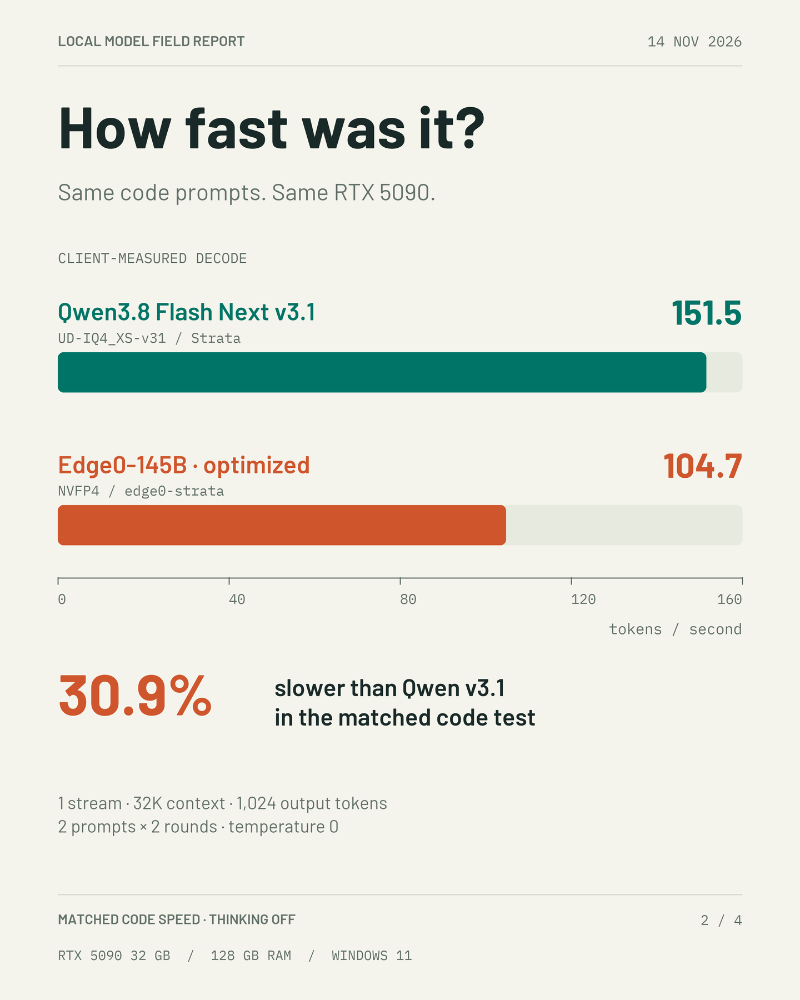

# RTX 5090 — Edge0 NVFP4 vs Strata IQ4

[简体中文](README.zh-CN.md) · [Hardware profile](../../hardware/rtx5090-9800x3d-128gb.json) · [Configuration snapshots](configuration.json)

Measured on 14 November 2026 with one RTX 5090 32 GB, Ryzen 7 9800X3D and 128 GB installed RAM under Windows 11. This archive covers deployment validation, matched code-speed measurements, configuration tuning and an expanded quality comparison.

## Results

| Measurement | Edge0-145B-NVFP4, optimized | Qwen3.8 Flash Next UD-IQ4_XS-v31 |
|---|---:|---:|
| Sustained code generation, client stream | 104.7 tok/s | 151.5 tok/s |
| Median first-content latency, same speed runs | 0.927 s | 1.192 s |
| Complex code tasks passed | 7/12 | 9/12 |
| Chinese reasoning tasks passed | 16/16 | 16/16 |
| Multi-turn simulated-tool tasks passed | 12/12 | 12/12 |
| Overall quality attempts passed | 35/40 | 37/40 |
| Summed model-request time, quality suite | 603.1 s | 466.9 s |

The optimized Edge0 configuration generated code 30.9% more slowly and used 29.2% more model-request time across the quality suite. Model-request time excludes startup and grading. The 40 attempts per model repeat 20 tasks twice.

**Personal verdict** — I am not recommending Edge0 yet and will keep watching updates. Qwen3.8 Flash Next UD-IQ4_XS-v31 remains my pick for speed and quality in this class, based on these two local deployments and this suite. “v3.1” in the graphics refers to this local v31 configuration.

## Versions and deployment

| Component | Recorded version or setting |
|---|---|
| Edge0 source | `f833336e487f61848ab5d49b2e7d06678812ea8a` |
| Edge0 weights | `cf9b3679e7da201a658a694e1730607193f2b032` |
| Edge0 runtime | Official `edge0-infer` service with the bundled `edge0-strata` backend, native Windows |
| Edge0 compilation | CUDA 13.4.59, MSVC 14.44.35207 |
| Original Strata runtime | 0.1.59, `f-0213-rc`, commit `712fec6b4297`, prebuilt CUDA 13.0 |
| NVIDIA driver | 616.92 |
| OS | Windows 11 Pro 25H2, build 26200.9974 |
| Configured context | 32,768 tokens for both deployments |
| Engine slots / simultaneous clients | Edge0 1 / 1, original Strata 8 / 1 |
| GPU power limit | 600 W observed |

Edge0 used Q8 D/U projections, INT8 KV, direct PLE I/O, an automatic expert cache, resident experts, MTP window 4 and minimum probability 0.5. The retained optimization was `--adapt-async 1`. VRAM reserve was 3,072 MiB and host resident-expert headroom was 16 GiB. The observed expert cache contained 8,893 experts using 16.03 GiB on GPU, with a 33.66 GiB locked host complement.

The Edge0 download comprised 27 files and 112,854,101,214 bytes, approximately 105.10 GiB. All LFS SHA-256 values and regular Git blob SHA-1 values matched the pinned manifest. All four original Strata GGUF files were also SHA-256 verified. The first measured readiness time was 27.197 s following the hash scan; a restart took 17.761 s. Later observed starts were roughly 16–18 s and benefited from the machine's existing filesystem state.

Initial deployment checks passed Chinese dialogue, code execution, multi-turn recall and a 30,476-token input. The long-input engine-reported effective prompt-processing rate was 2,134.4 tok/s initially and approximately 2,140 tok/s after tuning. These are request-level engine timings. Kernel-level prefill throughput was not measured.

Initial validation peaked at 29,343 MiB GPU use with a minimum 2,845 MiB free. Minimum available system RAM was 69,027 MiB. Engine RSS peaked at 38,492 MiB and private committed memory at 69,216 MiB. The final matched speed run peaked at 29,309 MiB GPU use, versus 31,155 MiB for original Strata. Respective minimum available system RAM was 69,852.9 and 18,968.7 MiB.

Source material and exact file hashes are linked below. Model weights are obtained from the original publisher.

- [Official Edge0 model and weights](https://huggingface.co/Edge0/Edge0-145B-NVFP4)
- [Official Edge0 repository](https://github.com/Edge0-AI/Edge0)
- [Official model documentation at the tested commit](https://github.com/Edge0-AI/Edge0/blob/f833336e487f61848ab5d49b2e7d06678812ea8a/docs/models/edge0-145b.md)
- [Weight manifest and verification](data/weight-manifest.json)
- [Deployment responses and measured timings](data/deployment-details.json)

## Matched speed experiment

Two identical synthetic code-generation prompts requested an async SQLite scheduler and a write-ahead-log key-value store. Each ran twice, with the order reversed in round two. There was one outstanding request, temperature 0, seed 42, thinking disabled and a 1,024-token output cap. All four requests in each primary comparison produced 1,024 tokens and reported zero cached prompt tokens. Actual sustained input length was 114 or 120 tokens, depending on the prompt. The 32K setting is capacity, while these speed inputs are short.

Client stream decode rate is `(completion_tokens - 1) / (last_content_time - first_content_time)`. The headline aggregate sums the token numerators and decode durations over four requests. First-content latency is measured separately and includes prompt processing. SSE chunk timing is an approximation of token delivery. The forced 1,024-token code continuations are throughput workloads; their incomplete modules are not the complex-code quality score.

| Edge0 configuration | Client tok/s | Sustained requests | Small code gate |
|---|---:|---:|---:|
| Initial baseline | 97.5 | 4 | 6/8 |
| Independently restarted baseline | 100.4 | 4 | 7/8 |
| Async expert-cache update confirmation | 107.7 | 4 | 6/8 |
| Async plus MTP minimum probability 0.8 | 109.5 | 4 | 6/8 |
| Retained configuration, final service validation | 104.7 | 4 | 6/8 |
| Original Strata IQ4 comparison | 151.5 | 4 | 6/8 |

The retained change improved throughput by 7.4% against the initial baseline and 4.3% against the restarted baseline. The faster combined candidate produced an incorrect interval-merging result in the small code gate. The retained configuration kept minimum probability 0.5. Zero-temperature output varied across restarts, as shown by the baseline's 6/8 and 7/8 gate results.

Thirteen small parameter screens used two sustained requests each. Four screens reused a process and recorded prompt-cache hits of 113 and 107 tokens. Those first-content latencies are not directly comparable with cold-request latencies. Full confirmations used zero prompt-cache hits.

| Screen | Client tok/s |
|---|---:|
| PCIe fraction 0 | 96.2 |
| PCIe fraction 0.1 | 99.5 |
| MTP minimum probability 0.2 | 98.9 |
| MTP minimum probability 0.8 | 102.6 |
| Main thread on last physical core | 93.9 |
| MTP window 6 | 91.9 |
| Resident-expert preparation overlap | 93.4 |
| Q4 D/U projections | 100.0 |
| PLE in RAM | 64.8 |
| Async expert-cache updates | 103.5 |
| Update cache every 32 rounds | 79.6 |
| Static expert cache | 58.9 |
| PCIe fraction 1.0 | 55.4 |

PLE-in-RAM reduced available Windows commit headroom, shrinking the resident expert complement to 12.34 GiB and increasing file reads. These screens suggest configuration-specific effects, with no isolated attribution of the overall speed gap to one kernel or component.

## Expanded quality experiment

The same 20 synthetic tasks ran twice per model in ABBA model order, with fresh runtime restarts between rounds. Round two reversed task order. Seeds were 42 and 43, temperature 0, top-p 1, neutral penalties and thinking enabled. Code and Chinese reasoning used a 1,536-token reasoning budget, tool turns 768, and every response had a 6,144-token output cap.

Actual request input lengths ranged from 134 to 4,068 tokens. All code and standalone reasoning requests reported zero cached tokens. For each model, 40 of 52 tool API turns reused conversation prefixes, with a maximum 1,176 cached tokens. Multi-turn cache state is retained in the request CSV. Each model issued 80 API requests and 60 simulated tool calls. Both completed with zero tool errors and zero output-length finishes.

- Six code tasks covered interval overlay, atomic patching, task scheduling, capped allocation, row selection and event reconciliation. The suite contains 216 normal and edge-case checks across the six functions. The task passes only if all of its checks pass. All 24 generated code outputs were regraded without a score change.
- Eight Chinese tasks covered deduplication, logic assignment, conditional probability, date/time, constrained selection, integer-cent discounts, version precedence and long-document amendments.
- Six tool workflows covered latency, ledger, release, calendar, inventory and incidents. Tools operated on synthetic in-memory records. Scoring checked reads, revision-aware updates, verification and the final receipt.

Paired outcomes were 34 both-pass, 2 both-fail, 1 Edge0-only pass and 3 Strata-only passes. Edge0 failures included an undefined variable, zero-duration scheduling and query parsing. Strata had one empty final code response after reasoning. Detailed verdicts and full synthetic responses are archived.

Both models reached the ceiling on Chinese and tool tasks. This small repeated suite does not establish a general model ranking. The tested architectures, quantizations, runtime versions, slot counts and memory policies differ. Larger diverse benchmarks, long-running reliability and equal-memory-budget comparisons remain unmeasured.

## Reproduction and archived evidence

| File | Contents |
|---|---|
| [Aggregate JSON](data/summary.json) | Deployment, speed variants, quality totals and paired outcomes |
| [Speed request CSV](data/speed-requests.csv) | 50 sustained requests and 48 small code-gate requests |
| [Speed details](data/speed-details.json) | Exact synthetic prompts, outputs, timing fields and memory samples |
| [Quality task CSV](data/quality-tasks.csv) | 80 scored attempts |
| [Quality request CSV](data/quality-requests.csv) | 160 API requests, actual lengths, caches and wall times |
| [Quality details](data/quality-details.json) | Outputs, reasoning, verdicts, simulated tool traces and sampled memory |
| [Quality suite](data/quality-suite.json) | Fixed prompts, expected answers and test inputs |
| [Configuration](configuration.json) | Sanitized deployment snapshots and tuning overrides |
| [Chinese deployment notes](deployment-notes.zh-CN.txt) | Original dated deployment narrative |
| [Chinese speed notes](speed-notes.zh-CN.txt) | Original dated speed and tuning narrative |
| [Chinese quality notes](quality-notes.zh-CN.txt) | Original dated quality narrative |
| [Scripts and commands](scripts/README.md) | Portable replay, graders and deployment helpers |
| [SHA-256 manifest](SHA256SUMS.txt) | Integrity of this report's files |

Host paths and internal endpoints were replaced with placeholders. Host process inventories and service logs were excluded. Original request hashes describe the recorded request bodies. Portable scripts have path and entry-point changes described in their README. All service-state statements in the original notes describe 14 November 2026 observations.

## English image list and X draft

| Image | Content |
|---|---|
| [01 — Model overview](assets/01-model-overview.png) | Local model, hardware and settings |
| [02 — Code speed](assets/02-code-speed.png) | Matched client-stream generation |
| [03 — Quality results](assets/03-quality-results.png) | Complex code, Chinese reasoning and tools |
| [04 — Verdict](assets/04-verdict.png) | Personal recommendation and limits |

The four PNGs are 1,440 × 1,800. [English text report](social/English-report.txt) and [X draft](social/X-post.txt) are ready to reuse. No social post was published as part of this archive.

## Archive corrections

2026-11-14 — Publication replaces host-specific paths and endpoints with placeholders, adds portable replay entry points, and collects measured request lengths and tool-cache counts from the saved responses. Original numeric measurements and grading outcomes are preserved.
